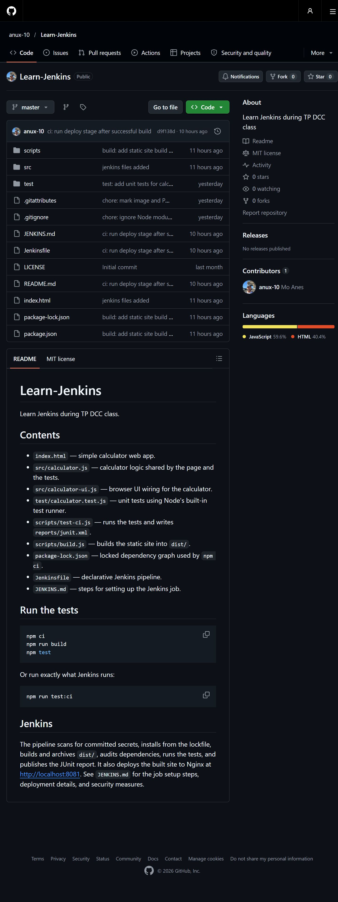
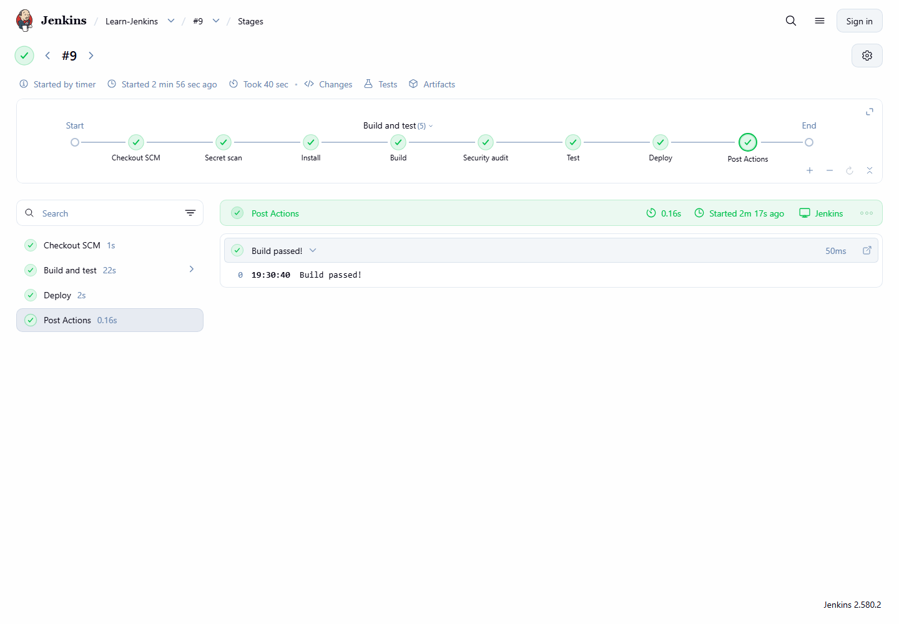
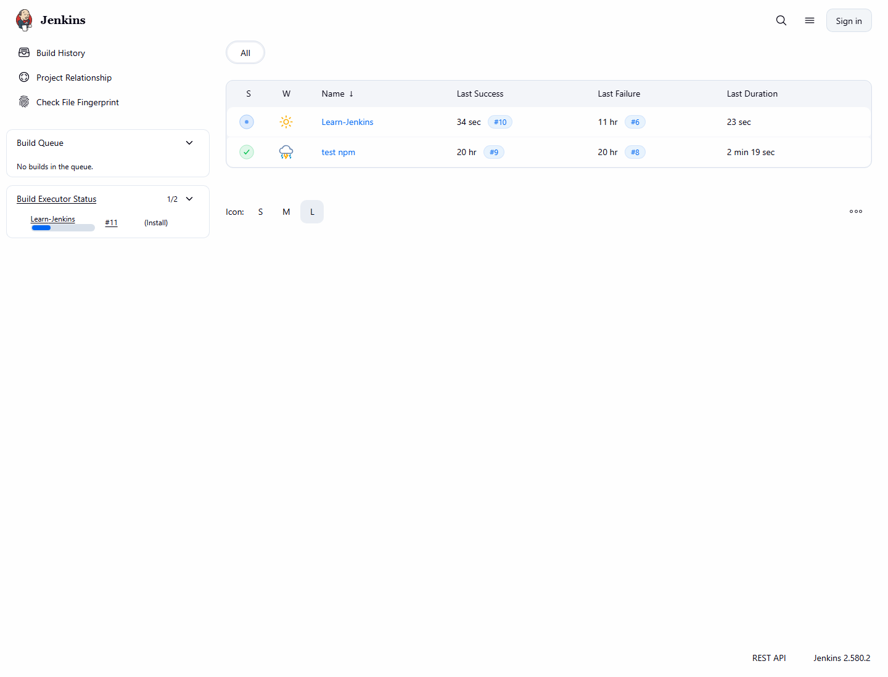
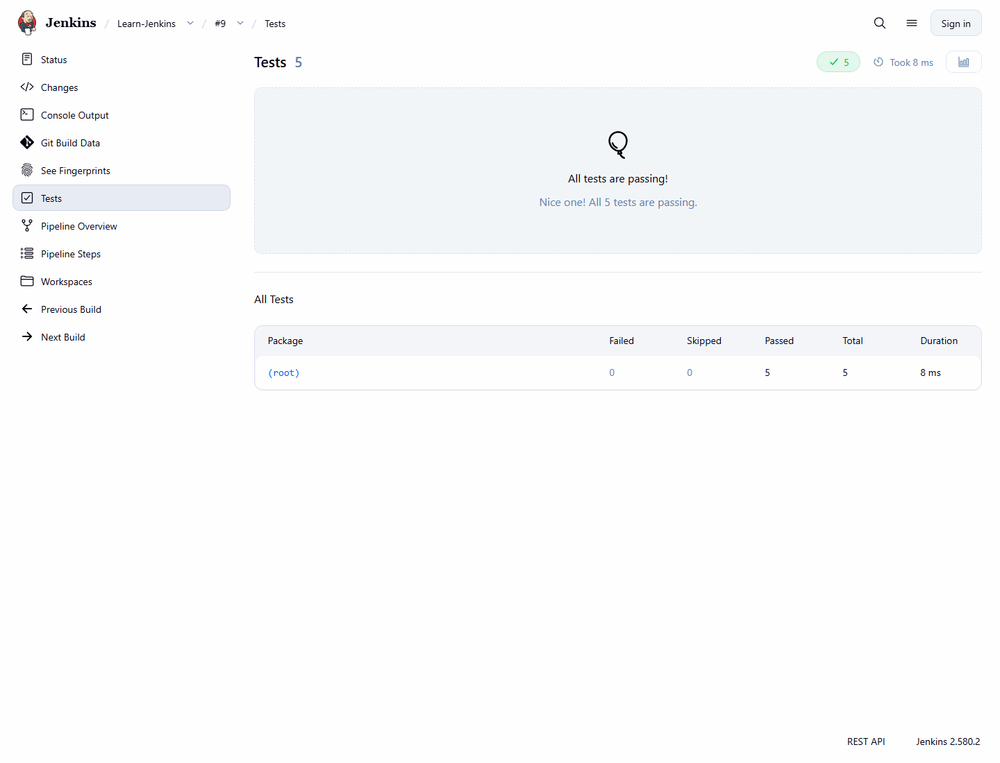

# CI/CD Report — Learn-Jenkins

**Repository:** https://github.com/anux-10/Learn-Jenkins
**Jenkins job:** http://localhost:8080/job/Learn-Jenkins/
**Deployed site:** http://localhost:8081/

This report shows the full CI/CD pipeline implemented in Jenkins for the
Learn-Jenkins project: repository, Jenkins pipeline, automated tests, and the
deployed application.

---

## 1. Repository

The project lives on GitHub at
[github.com/anux-10/Learn-Jenkins](https://github.com/anux-10/Learn-Jenkins).
Jenkins checks out the `master` branch and reads the `Jenkinsfile` from the
repository root.



---

## 2. Jenkins CI/CD pipeline

The declarative `Jenkinsfile` defines six stages. The latest run, **build #9**,
finished in 40 seconds with every stage green, including **Deploy**.

| # | Stage | What it does |
| --- | --- | --- |
| 1 | Secret scan | Fails the build if obvious secrets are committed |
| 2 | Install | `npm ci` from the lockfile inside a pinned Node 24 container |
| 3 | Build | `npm run build` produces `dist/` and archives it as an artifact |
| 4 | Security audit | `npm audit --audit-level=high` |
| 5 | Test | Verifies `dist/index.html` and runs `npm run test:ci` |
| 6 | Deploy | Publishes `dist/` to Nginx at http://localhost:8081 |



Jenkins dashboard with the job list:



---

## 3. Tests

The project uses Node's built-in test runner. Jenkins runs `npm run test:ci`,
which executes the suite and writes a JUnit report to `reports/junit.xml`.
The report is published on the build page.



Local run of the same command:

```bash
npm run test:ci
```

```
✔ adds two numbers
✔ subtracts two numbers
✔ multiplies two numbers
✔ divides two numbers
✔ throws when dividing by zero
ℹ tests 5
ℹ pass 5
ℹ fail 0
```

---

## 4. Deployment

The `Deploy` stage recreates the `learn-jenkins-site` container and copies the
built `dist/` folder into it, then checks that the page contains
"Simple Calculator".


| Item | Value |
| --- | --- |
| URL | http://localhost:8081 |
| Container | `learn-jenkins-site` |
| Image | `nginx:alpine@sha256:713fc2eb…` (pinned by digest) |
| Restart policy | `unless-stopped` |

---

## 5. Commands used

Trigger a build:

```bash
curl -X POST http://localhost:8080/job/Learn-Jenkins/build
```

Run the pipeline steps locally:

```bash
npm ci
npm run build
npm run test:ci
```

Deploy manually (what the Deploy stage runs):

```bash
docker rm -f learn-jenkins-site
docker run -d --name learn-jenkins-site --restart unless-stopped \
  --security-opt=no-new-privileges -p 8081:80 \
  nginx:alpine@sha256:713fc2ebfd92e8217db451477182ee91944b123d2b1ee9fd5a8c6e91ca6c3a11
docker cp dist/. learn-jenkins-site:/usr/share/nginx/html/
docker exec learn-jenkins-site wget -qO- http://localhost/ | grep -q 'Simple Calculator'
```

Verify the deployment:

```bash
curl -I http://localhost:8081/
docker ps --filter name=learn-jenkins-site
```

---

## 6. Security measures

- Pinned Node 24 and Nginx images by digest.
- Containers run with `--cap-drop=ALL` and `--security-opt=no-new-privileges`.
- Build timeout of 15 minutes and `disableConcurrentBuilds()`.
- Secret scan stage blocks obvious credentials.
- `npm audit --audit-level=high` fails on high-severity vulnerabilities.
